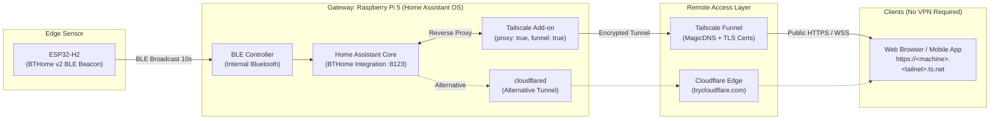
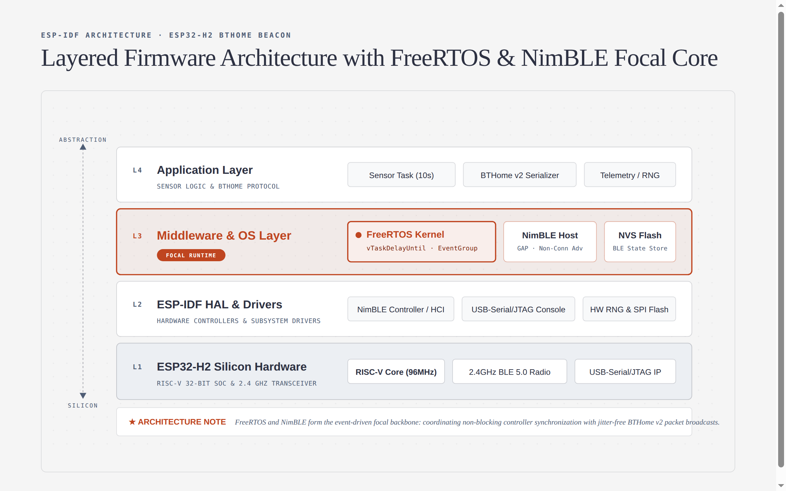
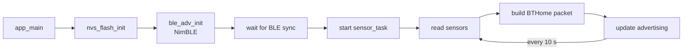
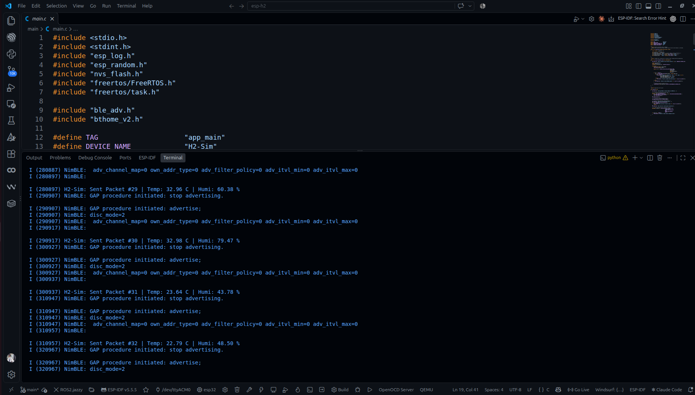
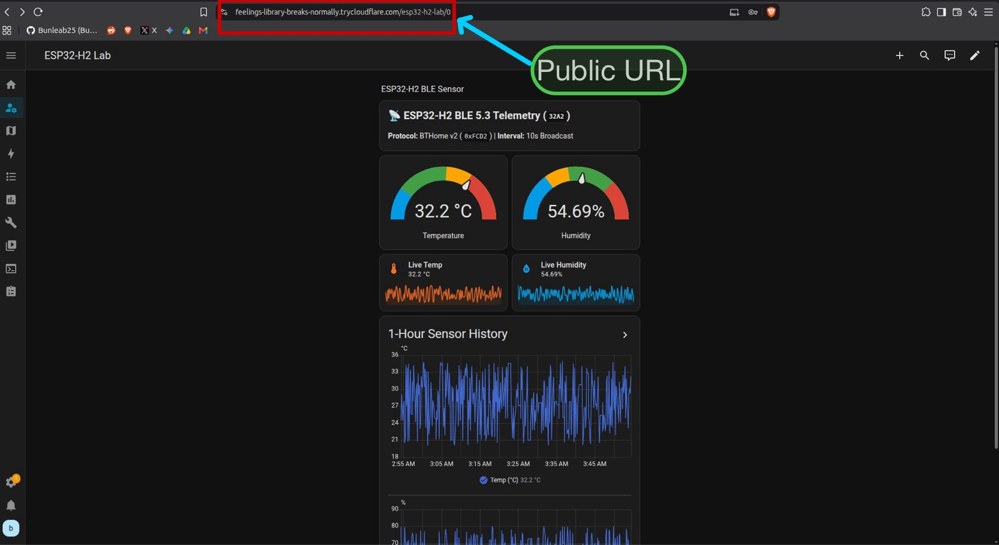

# ESP32-H2 → Raspberry Pi 5 → Tailscale Funnel: BLE Telemetry 

Build a small IoT pipeline: an **ESP32-H2** broadcasts temperature and humidity over Bluetooth LE, a **Raspberry Pi 5** running **Home Assistant** collects it, and **Tailscale Funnel** exposes the dashboard securely to the public internet with a persistent HTTPS URL. No port forwarding or custom domain is required (with Cloudflare Tunnel documented as an alternative option).



| Stage | What it does | Key idea |
|---|---|---|
| ESP32-H2 | Broadcasts sensor readings | BTHome v2 beacon |
| Home Assistant | Receives, stores and displays data | Local hub on Pi 5 |
| Tailscale Add-on | Routes encrypted traffic & terminates Funnel | `proxy: true`, `funnel: true` |
| Tailscale Funnel | Public HTTPS endpoint with valid TLS | Fixed `*.ts.net` URL, zero router config |
| Browser / Phone | Views dashboard over standard HTTPS | Live view over WSS (no client app needed) |
| *Cloudflare Tunnel* | *(Alternative)* Outbound quick tunnel | Random `trycloudflare.com` URL |

---

## Part 1: ESP32-H2 firmware (ESP-IDF)

The firmware lives in [`esp_idf/esp-h2`](esp_idf/esp-h2). It sends a **non-connectable BLE advertisement** every 10 seconds. The advertisement uses the open **BTHome v2** format, so Home Assistant detects it automatically.

### Firmware stack



| Layer | Contents |
|---|---|
| L4 Application | Sensor task (10 s), BTHome v2 serializer, simulated telemetry |
| L3 Middleware | FreeRTOS, NimBLE host, NVS flash |
| L2 Drivers | NimBLE controller/HCI, USB-Serial/JTAG console, HW RNG |
| L1 Silicon | RISC-V core (96 MHz), 2.4 GHz BLE radio |

### Project layout

```text
esp_idf/esp-h2/
├── CMakeLists.txt          # project(esp-h2)
└── main/
    ├── main.c              # app_main + sensor task
    ├── ble_adv.c           # NimBLE init, advertising
    ├── bthome_v2.c         # packet serializer
    └── include/            # ble_adv.h, bthome_v2.h
```

### Startup flow



1. **`main.c`**: `app_main` initializes NVS (needed by BLE), starts NimBLE, waits for the controller sync event, then starts `sensor_task`.
2. **Sensor task**: runs at priority 5 with a 4096-byte stack. It uses `vTaskDelayUntil`, so the 10 s period doesn't drift.
3. **`read_sensors()`**: produces random values (20–35 °C, 40–80 %). Replace it with a real I2C/SPI driver when you attach a sensor.
4. **`ble_adv.c`**: NimBLE host task plus a FreeRTOS event group that signals "synced". It advertises non-connectable every 100–150 ms.
5. **`bthome_v2.c`**: packs the readings into the 31-byte BLE advertisement.

### BTHome v2 packet

| Field | Bytes | Value |
|---|---|---|
| Flags | `02 01 06` | LE general discoverable, no BR/EDR |
| Local name | `07 09 "H2-Sim"` | Device name |
| Service data length + type | `0C 16` | 12 bytes, service data |
| UUID | `D2 FC` | `0xFCD2` (BTHome), little endian |
| Header | `40` | v2, unencrypted |
| Packet ID | `00 <n>` | Increments every packet |
| Temperature | `02 <lo> <hi>` | int16, ×0.01 °C |
| Humidity | `03 <lo> <hi>` | uint16, ×0.01 % |

Example: `0x09C4` = 2500 → **25.00 °C**.

### Build and flash

Requires [ESP-IDF](https://docs.espressif.com/projects/esp-idf/en/latest/esp32h2/get-started/) (v5.x).

```bash
. $HOME/esp/esp-idf/export.sh
cd esp_idf/esp-h2
idf.py set-target esp32h2
idf.py menuconfig          # Component config → Bluetooth → enable Bluetooth, select NimBLE
idf.py build flash monitor
```

Expected log:

```text
app_main: Starting BTHome v2 Sensor Beacon on ESP32-H2...
ble_adv: NimBLE host synced. Device Address: xx:xx:xx:xx:32:a2
app_main: Packet #1 broadcasted | Temp: 27.31 °C | Humi: 62.40 %
```

Real output in the VS Code ESP-IDF terminal (ESP-IDF v5.5.5). A new packet is sent every 10 s, and NimBLE stops and restarts advertising each time to load the new payload:



> [!NOTE]
> The last two bytes of the device address (`32A2` here) become part of the Home Assistant entity names, so yours will differ.

---

## Part 2: Home Assistant on the Raspberry Pi 5

Home Assistant listens for the BLE advertisement, decodes the BTHome packet and turns it into sensor entities.

### 2.1 Install Home Assistant OS

1. Open **Raspberry Pi Imager** and choose **Other specific-purpose OS → Home assistants and home automation → Home Assistant → Home Assistant OS (RPi 5, 64-bit)**.
2. Write it to an SD card or NVMe drive, put it in the Pi 5 and power it on.
3. After a few minutes, open `http://homeassistant.local:8123`. If that doesn't resolve, use `http://<pi-ip>:8123`. Create your account.

### 2.2 Check that Bluetooth works

Install the **Advanced SSH & Web Terminal** add-on (turn **Protection mode** off), then run:

```bash
ha host info                 # confirms the host is healthy
bluetoothctl list            # should list the Pi's controller
bluetoothctl show | grep Powered   # Powered: yes
```

If it shows `Powered: no`:

```bash
bluetoothctl power on
```

### 2.3 Confirm the ESP32-H2 is broadcasting

Scan for the beacon (`H2-Sim` is the `DEVICE_NAME` in `main.c`):

```bash
bluetoothctl --timeout 15 scan on | grep -i "H2-Sim"
```

You should see a line like `[NEW] Device AA:BB:CC:DD:32:A2 H2-Sim`. Its last two bytes are the `32A2` tag used in the entity names.

### 2.4 Add the BTHome integration

1. Go to **Settings → Devices & services**.
2. The **BTHome** card appears under *Discovered* within about 10 s. Click **Configure**.
3. Click **Submit**, then assign the device to an area, for example *Living Room*.

If nothing is discovered, add it manually with **+ Add Integration → BTHome**. Check that the Pi is within range of the ESP32-H2.

### 2.5 Check the entities

Open **Developer tools → States** and filter on `32a2`. You should see two sensors:

| Entity | Unit | Source object |
|---|---|---|
| `sensor.living_room_h2_sim_32a2_temperature` | °C | `0x02` |
| `sensor.living_room_h2_sim_32a2_humidity` | % | `0x03` |

> [!NOTE]
> The exact IDs depend on your area, the device name (`H2-Sim`) and the address suffix. Copy the real ones from the States page and use them in every snippet below.

To test from a template, open **Developer tools → Template** and paste:

```jinja
Temp: {{ states('sensor.living_room_h2_sim_32a2_temperature') }} °C
Humi: {{ states('sensor.living_room_h2_sim_32a2_humidity') }} %
Last update: {{ states.sensor.living_room_h2_sim_32a2_temperature.last_updated }}
```

The values should change every 10 s, matching the packets in your serial monitor.

### 2.6 Build the dashboard

1. Go to **Settings → Dashboards → Add dashboard**.
2. Set the title to `ESP32-H2 Lab` and the URL to `esp32-h2-lab`.
3. Open it, click **✏ → ⋮ → Raw configuration editor**, and paste:

```yaml
title: ESP32-H2 Lab
views:
  - title: ESP32-H2 BLE Sensor
    path: "0"
    cards:
      - type: vertical-stack
        cards:
          # Header
          - type: markdown
            content: |
              ## 📡 ESP32-H2 BLE 5.3 Telemetry (`32A2`)
              **Protocol:** BTHome v2 (`0xFCD2`) | **Interval:** 10s Broadcast

          # Gauges with color-coded severity
          - type: horizontal-stack
            cards:
              - type: gauge
                entity: sensor.living_room_h2_sim_32a2_temperature
                name: Temperature
                min: 0
                max: 50
                needle: true
                segments:
                  - { from: 0,  color: "#2196f3" }   # cold
                  - { from: 20, color: "#4caf50" }   # comfortable
                  - { from: 30, color: "#ff9800" }   # warm
                  - { from: 38, color: "#f44336" }   # hot
              - type: gauge
                entity: sensor.living_room_h2_sim_32a2_humidity
                name: Humidity
                min: 0
                max: 100
                needle: true
                segments:
                  - { from: 0,  color: "#2196f3" }
                  - { from: 30, color: "#ff9800" }
                  - { from: 40, color: "#4caf50" }
                  - { from: 70, color: "#f44336" }

          # Live values with sparkline
          - type: horizontal-stack
            cards:
              - type: sensor
                entity: sensor.living_room_h2_sim_32a2_temperature
                name: Live Temp
                graph: line
                detail: 1
              - type: sensor
                entity: sensor.living_room_h2_sim_32a2_humidity
                name: Live Humidity
                graph: line
                detail: 1

          # 1-hour history
          - type: history-graph
            title: 1-Hour Sensor History
            hours_to_show: 1
            entities:
              - entity: sensor.living_room_h2_sim_32a2_temperature
                name: Temp (°C)
              - entity: sensor.living_room_h2_sim_32a2_humidity
                name: Humidity (%)
```

Save it. The result matches the dashboard screenshot in Part 3.

### 2.7 Optional: alert when the sensor goes silent

The beacon should arrive every 10 s. This automation sends a notification if the temperature hasn't updated for 2 minutes. Add it under **Settings → Automations → ⋮ → Edit in YAML**:

```yaml
alias: ESP32-H2 sensor offline
trigger:
  - platform: state
    entity_id: sensor.living_room_h2_sim_32a2_temperature
    to: unavailable
    for: "00:02:00"
action:
  - service: persistent_notification.create
    data:
      title: ESP32-H2 offline
      message: No BTHome packet received for 2 minutes. Check the beacon power and range.
```

### 2.8 Export history to CSV

1. Open **History** from the sidebar.
2. Pick the temperature and humidity entities and a time range.
3. Click **⋮ → Download data**.

The file looks like this:

```csv
entity_id,state,last_changed
sensor.living_room_h2_sim_32a2_temperature,29.7,2026-11-12T18:00:00.000Z
sensor.living_room_h2_sim_32a2_humidity,50.56,2026-11-12T18:00:03.143Z
```

---

## Part 3: Remote access with Tailscale Funnel (Primary)

With **Tailscale Funnel**, you can route public HTTPS traffic to your local Home Assistant instance on the Raspberry Pi 5 without router port forwarding, static public IPs, or purchasing a custom domain. Any browser or mobile phone can access the dashboard directly at a permanent `https://<machine>.<tailnet>.ts.net` address with automated Let's Encrypt certificates.

### 3.1 Prerequisites in Tailscale Admin Console

Before configuring Home Assistant, ensure your Tailnet has Funnel and HTTPS enabled:

1. Log in to the [Tailscale Admin Console](https://login.tailscale.com/admin).
2. Go to **DNS** and enable **MagicDNS**.
3. Under **HTTPS Certificates**, enable certificate provisioning so Tailscale can generate automated Let's Encrypt certificates for your machines.
4. Go to **Access Controls (ACLs)** and ensure the `funnel` attribute is permitted for your users/nodes (Tailscale provides a default Funnel ACL snippet):

```json
"nodeAttrs": [
  {
    "target": ["autogroup:member"],
    "attr": ["funnel"]
  }
]
```

### 3.2 Install and configure the Tailscale Add-on in Home Assistant OS

The official Home Assistant Community Tailscale add-on allows exposing Home Assistant via Tailscale Funnel directly from the supervisor:

1. In Home Assistant, navigate to **Settings → Add-ons → Add-on Store**.
2. Search for **Tailscale** and click **Install**.
3. Go to the **Configuration** tab of the Tailscale add-on:
   - Set `proxy: true` (enables reverse proxying to Home Assistant).
   - Set `funnel: true` (enables Tailscale Funnel to route public internet traffic to port 8123).
   - (Optional) Set `tags` (e.g. `tag:ha`) or leave default user authentication.
4. Click **Save**.
5. Switch to the **Info** tab, toggle **Start on boot** and **Watchdog** on, then click **Start**.
6. Open the add-on **Web UI** or view the logs to copy the authentication link, open it in your browser, and authorize the node into your Tailnet.

### 3.3 Trust reverse proxy in Home Assistant

Home Assistant's security model blocks HTTP traffic arriving from reverse proxies unless their IP addresses are explicitly trusted. Add the following block to `/config/configuration.yaml` (using the File Editor or Advanced SSH add-on):

```yaml
http:
  use_x_forwarded_for: true
  trusted_proxies:
    - 127.0.0.1
    - ::1
    - 172.30.32.0/23    # Docker container subnet for Home Assistant Supervisor add-ons
    - 172.30.33.0/24    # Default HA add-on proxy subnet
    - 100.64.0.0/10     # Tailscale Carrier Grade NAT range
```

Validate your configuration under **Developer Tools → YAML → Check Configuration**, then restart Home Assistant.

### 3.4 Access the dashboard from anywhere

Once connected, find your device's MagicDNS domain name in the Tailscale Admin Console or add-on log:

```text
https://<machine-name>.<tailnet-name>.ts.net
```

Open this URL on any web browser or phone anywhere on the public internet. No Tailscale client installation or VPN login is required on client devices.

> [!TIP]
> If you prefer restricting access strictly to devices authenticated on your private Tailnet, change `funnel: false` in the add-on configuration. The dashboard will then only be accessible to your own devices via `http://<machine-name>:8123` or your 100.x.y.z IP.

---

### Alternative: Public access with Cloudflare Tunnel

<details>
<summary>Click to expand Cloudflare Tunnel instructions (legacy / alternative)</summary>

The Pi opens an **outbound** QUIC connection to Cloudflare, so you don't need to open any router ports. This also works behind carrier-grade NAT.

#### 1. Trust the proxy in Home Assistant

Add this to `/config/configuration.yaml`:

```yaml
http:
  use_x_forwarded_for: true
  trusted_proxies:
    - 127.0.0.1
    - ::1
    - 172.30.33.0/24
```

Check the config under **Developer Tools → YAML**, then restart Home Assistant.

#### 2. Run cloudflared as a service

```bash
curl -L https://github.com/cloudflare/cloudflared/releases/latest/download/cloudflared-linux-arm64 -o cloudflared
sudo install -m 755 cloudflared /usr/local/bin/

sudo tee /etc/systemd/system/cloudflared-tunnel.service > /dev/null <<'EOF'
[Unit]
Description=Cloudflare Quick Tunnel for Home Assistant
After=network.target

[Service]
ExecStart=/usr/local/bin/cloudflared tunnel --url http://127.0.0.1:8123
Restart=always
RestartSec=10

[Install]
WantedBy=multi-user.target
EOF

sudo systemctl daemon-reload
sudo systemctl enable --now cloudflared-tunnel
journalctl -u cloudflared-tunnel | grep trycloudflare.com   # your public URL
```

#### Result

Open the public URL from any browser or phone. The dashboard shows live gauges, mini trend tiles and a 1-hour history chart:



> [!NOTE]
> A quick tunnel gets a random URL that changes on restart. For a fixed address, use a named tunnel with your own domain.

</details>

---

## Troubleshooting

| Symptom | Cause | Fix |
|---|---|---|
| No BTHome device appears | Adapter off or out of range | Check Bluetooth on the Pi. Watch the ESP32 log for "Packet #…". |
| Build fails on `nimble/...` headers | NimBLE not enabled | Enable it in `menuconfig` (see Part 1). |
| `400: Bad Request` on public URL | Proxy headers not trusted | Add `127.0.0.1`, `::1`, and the Docker subnet (`172.30.32.0/23`) to `trusted_proxies` in `configuration.yaml` (Step 3.3). |
| `Unable to connect to Home Assistant` | WebSocket blocked | Tailscale Funnel supports WebSockets out-of-the-box. Ensure port 8123 is reachable locally and reverse proxy settings are applied. |
| Tailscale Funnel fails to start | Funnel not permitted in ACL | Open Tailscale Admin Console → Access Controls and add `"funnel"` to node attributes. |
| Tailscale Funnel shows SSL/TLS error | HTTPS certs not enabled in Tailnet | Enable **MagicDNS** and **HTTPS Certificates** in Tailscale Admin Console DNS settings. |
| Cloudflare tunnel stops after reboot | `cloudflared` not a service | Use the systemd unit in the Cloudflare alternative section. |
| `Entity not found` on a card | Entity ID differs | Copy the exact ID from **Developer Tools → States**. |

---

## References

- [BTHome v2 format](https://bthome.io/format/)
- [ESP-IDF for ESP32-H2](https://docs.espressif.com/projects/esp-idf/en/latest/esp32h2/)
- [Home Assistant BTHome integration](https://www.home-assistant.io/integrations/bthome/)
- [Tailscale Funnel Documentation](https://tailscale.com/kb/1223/funnel)
- [Home Assistant Community Add-on: Tailscale](https://github.com/hassio-addons/addon-tailscale)
- [Cloudflare Tunnel](https://developers.cloudflare.com/cloudflare-one/connections/connect-networks/)
