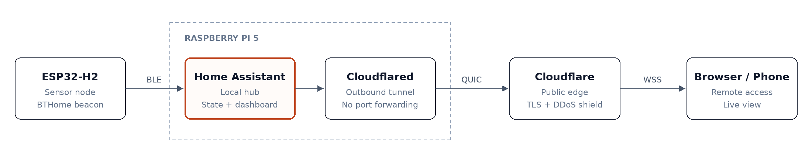

# BLE-Based Embedded Connectivity, Raspberry Pi Edge Gateway and Cloudflare-Powered Cloud Integration

An ESP32-H2 broadcasts temperature and humidity over BLE (BTHome v2). A Raspberry Pi 5 running Home Assistant collects the data. A Cloudflare Tunnel makes the dashboard reachable from anywhere, with no port forwarding.



## Repository layout

```text
.
├── README.md
├── docs/
│   ├── TUTORIAL.md          # full step-by-step guide
│   ├── architecture.png     # system diagram (also .html)
│   ├── firmware-stack.png   # ESP-IDF layer diagram
│   └── images/              # screenshots (serial monitor, dashboard)
└── esp_idf/
    └── esp-h2/              # ESP-IDF firmware (ESP32-H2)
        └── main/            # main.c, ble_adv.c, bthome_v2.c
```

## Quick start

```bash
. $HOME/esp/esp-idf/export.sh
cd esp_idf/esp-h2
idf.py set-target esp32h2
idf.py menuconfig        # Component config → Bluetooth → enable NimBLE
idf.py build flash monitor
```

Then follow [docs/TUTORIAL.md](docs/TUTORIAL.md) to set up Home Assistant and the Cloudflare Tunnel.
